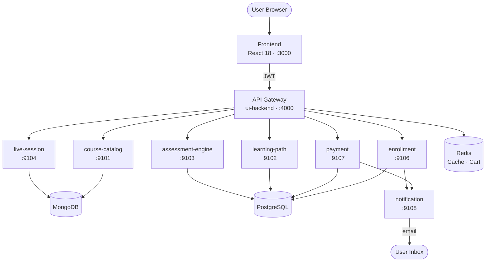
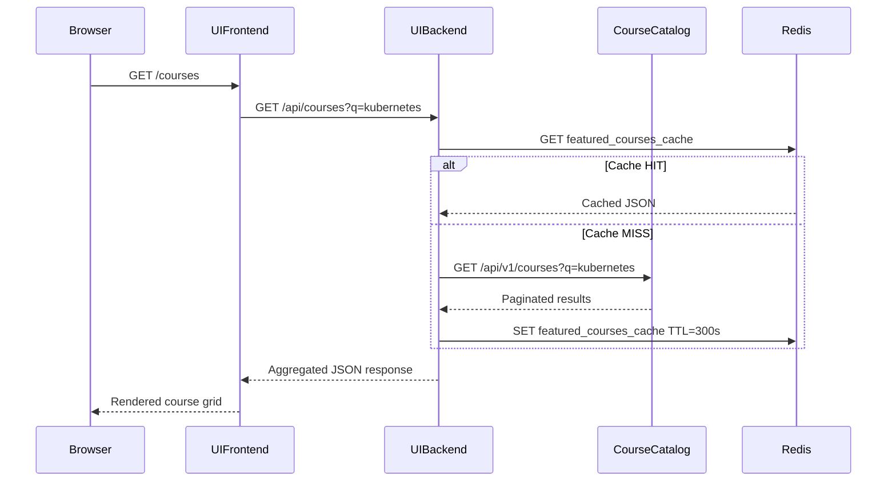
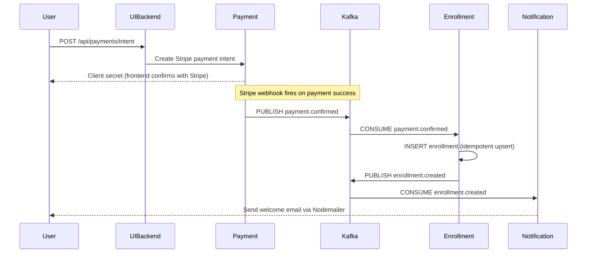
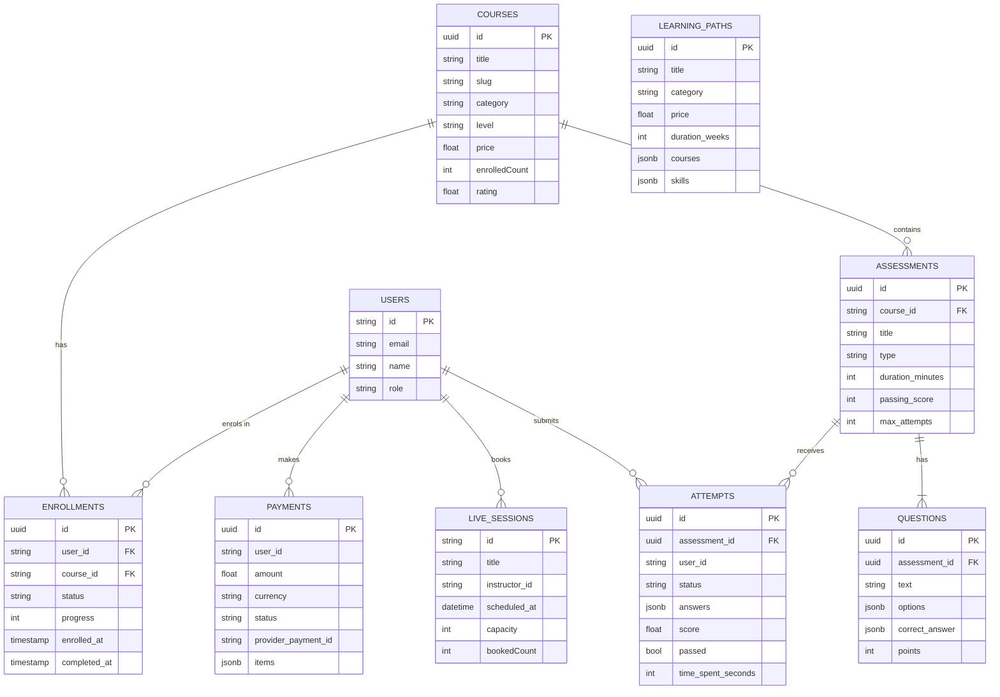
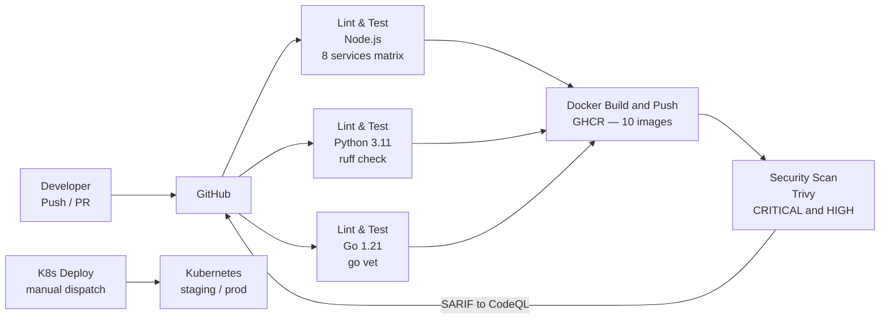
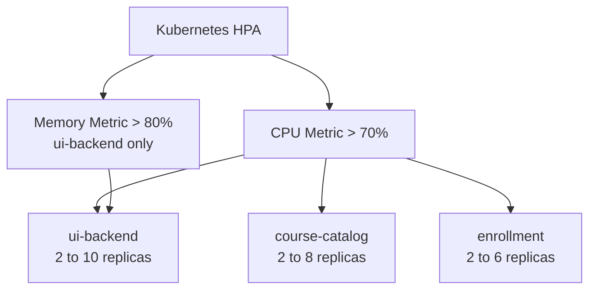
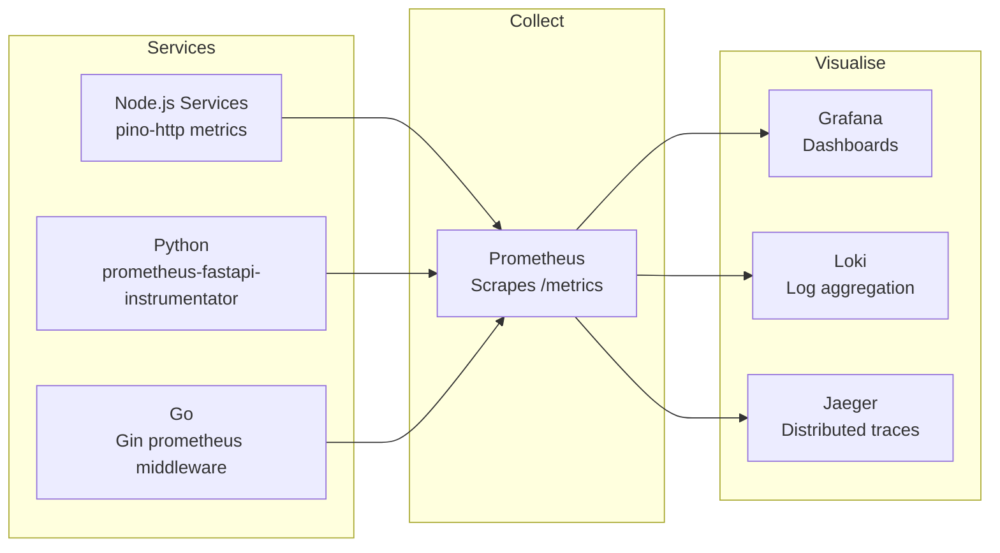

> ## My deployment work
> Project repo: [Project-1-LearnSphere_Skillfyme](https://github.com/jkirthi90/Project-1-LearnSphere_Skillfyme) (private)
>
> ```
> git push ─► GitHub Actions CI (lint, test, build 10 images) ─► GHCR
>                                                                 │
> k8s-lite/ on main ─► Argo CD (auto-sync, self-heal) ─► kubeadm cluster (3 nodes)
>                                                                 │
> browser ─► Gateway API (/api → backend, / → frontend) ─► LearnSphere services
>                                                                 │
>                              Prometheus + Grafana ◄─ nodes, pods, cluster
> ```
>
> | Step | What | Notes |
> |------|------|-------|
> | 1 | [Docker Compose](./docker-compose) | Single EC2, fixed the Postgres seed script |
> | 2 | [Kubernetes](./kubernetes) | Where the original manifests break, fixed `k8s-lite` manifests, CI-built images |
> | 3 | [Argo CD](./argocd) | GitOps deployment with self-heal |
> | 4 | [Gateway API](./gateway-api) | Single entry point with path routing |
> | 5 | [Monitoring](./monitoring) | Prometheus + Grafana with kube-prometheus-stack |
>
> Below is the original project README, unchanged.

---

# LearnSphere — Enterprise Learning Platform

> A polyglot microservices platform for enterprise-grade online learning, skill development, and workforce upskilling — built on cloud-native principles.

[](#19-license)
[](https://nodejs.org)
[](https://python.org)
[](https://go.dev)
[](https://docker.com)
[](https://kubernetes.io)
[](https://github.com/features/actions)

---

## Table of Contents

1. [Project Overview](#1-project-overview)
2. [Business Problem](#2-business-problem)
3. [Objectives](#3-objectives)
4. [Key Features](#4-key-features)
5. [Architecture](#5-architecture)
6. [Microservices](#6-microservices)
7. [Tech Stack](#7-tech-stack)
8. [Folder Structure](#8-folder-structure)
9. [Database Design](#9-database-design)
10. [API Documentation](#10-api-documentation)
11. [Security Implementation](#11-security-implementation)
12. [CI/CD Pipeline](#12-cicd-pipeline)
13. [Deployment Architecture](#13-deployment-architecture)
14. [Monitoring & Observability](#14-monitoring--observability)
15. [Installation & Setup](#15-installation--setup)
16. [Interview Coverage](#16-interview-coverage)
17. [Challenges & Learnings](#17-challenges--learnings)
18. [Future Enhancements](#18-future-enhancements)
19. [License](#19-license)

---

## 1. Project Overview

**LearnSphere** (package namespace: `@skillfyme`) is a production-grade, cloud-native e-learning platform built to demonstrate enterprise software architecture in a real, working codebase. It delivers a complete end-to-end learning ecosystem — course discovery, personalised learning paths, live mentoring sessions, competency assessments, enrollment, and payment — across **10 independently deployable microservices** written in **3 programming languages**.

| Attribute | Detail |
|-----------|--------|
| **Project Type** | Cloud-native polyglot microservices platform |
| **Domain** | EdTech / Enterprise Learning Management |
| **Architecture** | Microservices (BFF + 9 domain services) |
| **Languages** | JavaScript (Node.js), Python 3.11, Go 1.21 |
| **Services** | 10 application + 5 infrastructure (MongoDB, PostgreSQL, Redis, Elasticsearch, Kafka) |
| **Target Users** | Learners, instructors, enterprise HR teams, platform administrators |
| **Business Model** | Course marketplace + subscription learning paths + live sessions |

---

## 2. Business Problem

### The Challenge

Modern enterprises face a critical skills gap: workforce upskilling programmes are fragmented across disconnected tools — LMS platforms that don't talk to payment systems, assessment engines isolated from course catalogs, notification systems bolted on as afterthoughts.

### Specific Pain Points Addressed

| Problem | Impact | How LearnSphere Solves It |
|---------|--------|--------------------------|
| Fragmented learning tools | Learner drop-off, poor UX | Unified SPA with consolidated API gateway (BFF pattern) |
| No scalable course search | Revenue leakage — courses go undiscovered | Elasticsearch full-text + faceted search on course-catalog |
| Manual enrollment processing | High operational overhead | Kafka-driven saga: payment confirmed → enrollment → email, fully automated |
| Single language system lock-in | Talent hiring constraints | Polyglot: Node.js, Python, Go — right tool for each domain |
| Monolith deployment risk | Hours of downtime per release | 10 independently deployable services with rolling updates |
| No real-time capacity | Learners expect live instruction | Live session service with scheduling and Kafka-based reminders |

---

## 3. Objectives

### Technical Objectives

- Demonstrate **microservices decomposition** using Domain-Driven Design boundaries
- Implement **polyglot persistence**: MongoDB for flexible schemas, PostgreSQL for ACID transactions, Redis for ephemeral state, Elasticsearch for full-text search
- Showcase **asynchronous event-driven communication** (Kafka) alongside synchronous HTTP (BFF aggregation)
- Apply **cloud-native patterns**: health probes, HPA autoscaling, Istio service mesh readiness, multi-stage Docker builds
- Enable **zero-downtime deployments** via Kubernetes rolling updates and readiness gates

### Business Objectives

- Deliver a **production-grade course marketplace** with search, filtering, enrollment, and payment
- Support **personalised learning paths** as bundled skill curricula with PostgreSQL-backed tracking
- Automate the **payment-to-access** lifecycle via Kafka saga pattern
- Provide **real-time learning** through schedulable live sessions
- Issue **completion certificates** tied to assessment results

### Expected Outcomes

- Engineers can confidently answer **40+ system design interview questions** using this codebase as a reference
- Platform is deployable to any Kubernetes cluster with a single `kubectl apply -k` command
- All services independently deployable, testable, and scalable in isolation

---

## 4. Key Features

### Core Features

| Feature | Description | Business Benefit |
|---------|-------------|-----------------|
| **Course Catalog & Search** | Elasticsearch full-text search with category, level, price, and rating filters | Maximises course discoverability and conversion |
| **Personalised Learning Paths** | Curated multi-course bundles with prerequisite chaining (PostgreSQL + FastAPI) | Increases learner retention and upsell opportunity |
| **Live Sessions** | Schedulable live classes and webinars with Kafka-based booking reminders | Differentiates from async-only competitors |
| **Competency Assessments** | Timed quizzes and exams with multi-attempt control and score analytics (Go + PostgreSQL) | Validates skill mastery; drives certificate issuance |
| **Enrollment & Progress Tracking** | Atomic enrollment with `ON CONFLICT DO UPDATE`; real-time progress percentage | Accurate learner journey visibility |
| **Payment Processing** | Stripe payment intents + webhook confirmation + Kafka event dispatch | Reliable, fraud-protected revenue collection |
| **Credits & Currency FX** | In-platform credit wallet with atomic Redis counters and 10-currency FX rates | Supports international markets and promotional credits |
| **Certificate of Completion** | Awarded on 100% progress and passing assessment score | Tangible, verifiable credential for learners |

### Advanced Features

| Feature | Description | Business Benefit |
|---------|-------------|-----------------|
| **BFF API Gateway** | Single aggregation layer with JWT auth, Redis caching, and rate limiting | Reduced frontend complexity; single authenticated surface |
| **Redis Shopping Cart** | 1-hour TTL cart with atomic add/remove, per-user key isolation | Low-latency cart with automatic expiry |
| **Saga Pattern** | Payment confirmed → Kafka → Enrollment created → Welcome email dispatched | Decoupled, reliable transaction chain |
| **Polyglot Logging** | Pino (Node.js), structlog (Python), zerolog (Go) — all emit structured JSON | Centralised log aggregation via Loki |
| **Prometheus Metrics** | Per-service instrumentation via language-native libraries | Business KPIs + infrastructure dashboards in Grafana |

### Security Features

| Feature | Implementation |
|---------|---------------|
| Stateless JWT authentication | jsonwebtoken (HS256) verified in BFF auth middleware |
| HTTP security headers | Helmet.js: CSP, X-Frame-Options, HSTS, X-Content-Type-Options |
| API rate limiting | express-rate-limit: 20 req/15 min (auth), 200 req/min (API) |
| SQL injection prevention | Parameterised queries (`$1, $2`) in all PostgreSQL calls |
| Input validation | Zod (Node.js), Pydantic v2 (Python) — validated at every API boundary |
| Container CVE scanning | Trivy in CI/CD pipeline; blocks on CRITICAL/HIGH vulnerabilities |
| Service mesh mTLS | Istio-ready: namespace has `istio-injection: enabled` label |

---

## 5. Architecture

### System Architecture Diagram



### Request Flow



### Payment Saga Flow



---

## 6. Microservices

### Service Summary

| Service | Language | Port | Database | Primary Responsibility |
|---------|----------|------|----------|----------------------|
| [ui-frontend](services/ui-frontend) | React 18 + Vite | 3000 | — | Learner-facing SPA with lazy-loaded routes |
| [ui-backend](services/ui-backend) | Node.js 18 | 4000 | Redis | BFF: JWT auth, aggregation, caching, rate limiting |
| [course-catalog](services/course-catalog) | Node.js 18 | 9101 | MongoDB + ES | Course CRUD, full-text search, categories |
| [learning-path](services/learning-path) | Python 3.11 | 9102 | PostgreSQL | Curated skill path bundles, async SQLAlchemy |
| [assessment-engine](services/assessment-engine) | Go 1.21 | 9103 | PostgreSQL | Quizzes, exams, multi-attempt grading |
| [live-session](services/live-session) | Node.js 18 | 9104 | MongoDB | Live class scheduling, Kafka event publishing |
| [credits-currency](services/credits-currency) | Node.js 18 | 9105 | Redis | Credit wallet, atomic ledger, FX rates |
| [enrollment](services/enrollment) | Node.js 18 | 9106 | PostgreSQL | Enrollment upsert, progress tracking |
| [payment](services/payment) | Node.js 18 | 9107 | PostgreSQL | Stripe integration, webhook confirmation |
| [notification](services/notification) | Node.js 18 | 9108 | Kafka | Email dispatch via Nodemailer, Kafka consumer |

### Service Details

<details>
<summary><strong>ui-backend — Backend for Frontend (BFF)</strong></summary>

The BFF is the single API surface for the frontend. It handles:

- **JWT Authentication**: Issues and verifies HS256 tokens; attaches `req.user` to all downstream calls
- **Request Aggregation**: Proxies requests to 8 downstream services using service-discovery URLs from environment variables
- **Redis Caching**: Featured courses and category lists cached for 5 minutes; shopping cart stored per-user with 1-hour TTL
- **Rate Limiting**: `express-rate-limit` — 20 requests/15 minutes on `/api/auth`, 200 requests/minute on all other routes
- **Security Headers**: Helmet.js sets CSP, HSTS, X-Frame-Options, X-Content-Type-Options on every response

Downstream services are never called directly by the frontend. All traffic flows through the BFF, isolating the frontend from internal service topology changes.

</details>

<details>
<summary><strong>course-catalog — Node.js + MongoDB + Elasticsearch</strong></summary>

The course catalog handles the highest read volume in the system. Key design decisions:

- **Dual search backend**: Elasticsearch for full-text search with relevance ranking; MongoDB `$text` index as fallback when ES is unavailable
- **Compound indexes**: `category + level + status` for filtered browsing; `enrolledCount` and `rating` for sort operations
- **Flexible schema**: Course documents include nested modules (title, lessons, duration, topics), instructor info, pricing, and stats — all in one document for fast single-fetch renders
- **Pagination**: All list endpoints return `total`, `pages`, and `page` for cursor-based navigation

</details>

<details>
<summary><strong>assessment-engine — Go + Gin + PostgreSQL</strong></summary>

Written in Go for high-throughput exam processing:

- **Connection pooling**: `SetMaxOpenConns(25)`, `SetMaxIdleConns(5)`, `SetConnMaxLifetime(5min)` — tuned for concurrent exam submissions
- **JSONB storage**: `options`, `correct_answer`, and `answers` columns use PostgreSQL JSONB for schema flexibility without sacrificing query capability
- **Multi-attempt control**: `max_attempts` field enforced at the DB level; `attempts` table tracks every submission with score and time spent
- **Statically compiled binary**: Docker final stage uses `alpine:3.19` — no shell, minimal attack surface, sub-20MB image

</details>

<details>
<summary><strong>learning-path — Python + FastAPI + async SQLAlchemy</strong></summary>

The only Python service in the platform — chosen for its rich data-science ecosystem and FastAPI's async performance:

- **AsyncSession**: All database calls use `await db.execute(select(...))` — zero blocking I/O in the async event loop
- **Pydantic v2**: `LearningPathResponse` schema provides runtime type validation and auto-generated OpenAPI docs
- **Lifespan manager**: Table creation runs once on startup via `async_engine.begin()`
- **Alembic**: Migration framework for schema evolution without data loss

</details>

---

## 7. Tech Stack

### Frontend

| Technology | Version | Purpose |
|-----------|---------|---------|
| React | 18.2 | Component-based UI with concurrent rendering and Suspense |
| Vite | 5.0 | ESM-native build tool with HMR and multi-stage Docker build |
| TailwindCSS | 3.3 | Utility-first CSS; custom animations (blob drift, float, shimmer) |
| Radix UI | Latest | Accessible, unstyled headless UI primitives |
| React Router | 6 | Client-side routing with lazy-loaded page components |
| TanStack Query | 5 | Server-state management, background refetch, placeholder data |
| Zustand | 4.4 | Lightweight client-state (auth session persistence) |
| Axios | 1.6 | HTTP client with interceptor-based auth header injection |
| Lucide React | Latest | Consistent icon system |

### Backend

| Technology | Version | Used In | Purpose |
|-----------|---------|---------|---------|
| Node.js | 18 LTS | 8 services | JavaScript runtime |
| Express | 4.18 | All Node services | HTTP framework + middleware chain |
| Python | 3.11 | learning-path | Async service runtime |
| FastAPI | 0.104 | learning-path | High-performance async web framework |
| Go | 1.21 | assessment-engine | Low-latency exam processing |
| Gin | 1.9 | assessment-engine | Go HTTP framework with routing and middleware |
| Mongoose | 8.0 | course-catalog, live-session | MongoDB ODM with schema and index management |
| SQLAlchemy | 2.0 async | learning-path | Async ORM for PostgreSQL |
| jsonwebtoken | 9.0 | ui-backend | JWT generation and verification |
| Pino | 8.16 | All Node services | Structured JSON logging with child loggers |
| zerolog | 1.31 | assessment-engine | Zero-allocation structured logging for Go |
| structlog | 23.2 | learning-path | Structured logging for Python |
| Zod | 3.22 | Node services | Schema validation at API boundaries |
| Pydantic v2 | 2.5 | learning-path | Python runtime data validation |
| KafkaJS | 2.2 | live-session | Kafka producer for session events |
| Nodemailer | 6.9 | notification | SMTP email dispatch |
| Stripe SDK | Latest | payment | Payment intent creation and webhook handling |
| ioredis | 5.3 | ui-backend, credits | Redis client with connection pooling |
| Helmet.js | 7.x | All Node services | HTTP security headers |
| express-rate-limit | 7.1 | ui-backend | API and auth rate limiting |

### Database & Storage

| Technology | Version | Used By | Data Pattern |
|-----------|---------|---------|-------------|
| MongoDB | 7 | course-catalog, live-session | Document store — flexible nested schemas |
| PostgreSQL | 16 | learning-path, assessment, enrollment, payment | Relational — ACID transactions, FK constraints |
| Redis | 7 | ui-backend, credits-currency | In-memory KV — cart (1h TTL), cache (5m TTL), credit counters |
| Elasticsearch | 8.11 | course-catalog | Full-text search with relevance scoring and faceted filtering |
| Apache Kafka | 3.5 | enrollment, payment, notification, live-session | Distributed event log — durable, replayable |
| Zookeeper | 3.8 | Kafka coordination | Kafka cluster metadata management |

### DevOps & Infrastructure

| Technology | Version | Purpose |
|-----------|---------|---------|
| Docker | 24+ | Multi-stage containerisation (builder → nginx / alpine final stages) |
| Docker Compose | 2.x | Local multi-service orchestration with dependency ordering |
| Kubernetes | 1.28+ | Production container orchestration: Deployments, Services, Ingress, HPA |
| Kustomize | Built-in | Environment-specific overlays (dev vs prod) without templating |
| GitHub Actions | Latest | CI/CD: lint → test → Docker build → security scan → k8s deploy |
| Nginx | 1.25 | Static asset serving (SPA) and `/api/*` reverse proxy to BFF |
| Istio | 1.x | Service mesh readiness: namespace injection, mTLS, traffic management |
| cert-manager | Latest | Automatic TLS certificate provisioning via Let's Encrypt |
| Trivy | Latest | Container image vulnerability scanning in CI (CRITICAL/HIGH) |

### Observability

| Technology | Purpose |
|-----------|---------|
| Prometheus | Metrics collection from all 10 services via language-native instrumentators |
| Grafana | Business KPI dashboards and infrastructure resource dashboards |
| Jaeger | Distributed tracing across service boundaries |
| Loki | Centralised log aggregation and querying |

---

## 8. Folder Structure

```text
learnsphere-skillfyme/
├── services/
│   ├── ui-frontend/              # React 18 SPA
│   │   ├── src/
│   │   │   ├── pages/            # Route-level components (lazy-loaded)
│   │   │   ├── components/       # Layout, common, domain components
│   │   │   ├── store/            # Zustand auth store
│   │   │   ├── utils/            # Axios API client
│   │   │   └── styles/           # Tailwind global styles and component classes
│   │   ├── Dockerfile            # Node build → Nginx alpine (multi-stage)
│   │   ├── nginx.conf            # SPA routing + /api/* reverse proxy
│   │   ├── tailwind.config.js    # Custom animations, shadows, colours
│   │   └── postcss.config.js     # Tailwind + Autoprefixer plugins
│   │
│   ├── ui-backend/               # BFF — API gateway
│   │   ├── src/
│   │   │   ├── routes/           # auth, cart, courses, enrollments, payments, credits, ...
│   │   │   ├── middleware/       # JWT auth, error handler
│   │   │   └── server.js         # Express app bootstrap
│   │   └── Dockerfile
│   │
│   ├── course-catalog/           # Node.js + MongoDB + Elasticsearch
│   │   ├── src/
│   │   │   ├── models/           # Mongoose Course schema with indexes
│   │   │   ├── routes/           # courses.js — search and CRUD
│   │   │   └── server.js
│   │   └── Dockerfile
│   │
│   ├── learning-path/            # Python 3.11 + FastAPI
│   │   ├── src/
│   │   │   ├── main.py           # FastAPI app and lifespan DB init
│   │   │   ├── models.py         # SQLAlchemy async ORM models
│   │   │   ├── schemas.py        # Pydantic v2 request/response schemas
│   │   │   ├── routes/paths.py   # Learning path endpoints
│   │   │   └── database.py       # Async engine and session factory
│   │   ├── requirements.txt
│   │   └── Dockerfile
│   │
│   ├── assessment-engine/        # Go 1.21 + Gin
│   │   ├── src/
│   │   │   └── main.go           # Gin app, DB pool, SQL schema, handlers
│   │   ├── go.mod
│   │   └── Dockerfile            # Go builder → alpine:3.19 final
│   │
│   ├── live-session/             # Node.js + Mongoose + Kafka producer
│   ├── credits-currency/         # Node.js + Redis atomic operations
│   ├── enrollment/               # Node.js + PostgreSQL + Kafka producer
│   ├── payment/                  # Node.js + PostgreSQL + Stripe + Kafka
│   └── notification/             # Node.js + Nodemailer + Kafka consumer
│
├── k8s/
│   ├── base/
│   │   ├── namespace.yaml        # skillfyme namespace with Istio injection label
│   │   ├── configmap.yaml        # Service URLs and environment config
│   │   ├── microservices.yaml    # Deployments and Services for all domain services
│   │   ├── ui-frontend.yaml      # Frontend Deployment and Service
│   │   ├── ui-backend.yaml       # BFF Deployment and Service
│   │   ├── hpa.yaml              # HPA for ui-backend, course-catalog, enrollment
│   │   ├── ingress.yaml          # Nginx Ingress with TLS via cert-manager
│   │   └── kustomization.yaml
│   └── overlays/
│       ├── dev/                  # Reduced replicas overlay
│       └── prod/                 # Production configuration
│
├── docs/
│   ├── architecture/ARCHITECTURE.md
│   ├── deployment/DEPLOYMENT.md
│   ├── migration/
│   │   ├── MIGRATION_STRATEGY.md
│   │   └── TRANSFORMATION_CHECKLIST.md
│   ├── api/
│   │   ├── openapi-course-catalog.yaml
│   │   └── openapi-enrollment.yaml
│   └── DEVELOPER_GUIDE.md
│
├── scripts/
│   └── postgres-init.sql         # Schema and seed data for 4 databases; auto-run on startup
│
├── docker-compose.yml            # 10 app + 9 infra services (19 containers total)
├── package.json                  # Yarn workspace root — dev, test, lint, docker, k8s scripts
├── .github/
│   └── workflows/
│       ├── ci.yml                # Lint + test (Node, Python, Go) + Docker build + Trivy scan
│       └── deploy.yml            # Manual k8s deploy to staging or production
└── README.md
```

---

## 9. Database Design

### Database Responsibilities

| Database | Services | Data Characteristics |
|----------|----------|---------------------|
| **MongoDB 7** | course-catalog, live-session | Flexible nested documents (courses with modules, topics, instructor) |
| **PostgreSQL 16** | learning-path, assessment-engine, enrollment, payment | ACID transactions, FK integrity, JSONB for flexible sub-fields |
| **Redis 7** | ui-backend (cache/cart), credits-currency | Ephemeral; TTL-based expiry; atomic counters |
| **Elasticsearch 8.11** | course-catalog | Inverted index for full-text search; relevance scoring |

### Entity Relationship Overview



### PostgreSQL Schema Highlights

**`enrollments` — Idempotent Upsert Pattern**

```sql
-- Atomic, race-safe enrollment creation
INSERT INTO enrollments (user_id, course_id, status, progress)
VALUES ($1, $2, 'active', 0)
ON CONFLICT (user_id, course_id) DO UPDATE
  SET status = EXCLUDED.status, updated_at = NOW();

-- Indexes
CREATE INDEX idx_enrollments_user_id ON enrollments(user_id);
CREATE INDEX idx_enrollments_course_id ON enrollments(course_id);
```

**`attempts` — JSONB Flexible Answer Storage**

```sql
CREATE TABLE attempts (
  id UUID PRIMARY KEY DEFAULT gen_random_uuid(),
  assessment_id UUID REFERENCES assessments(id),
  user_id VARCHAR NOT NULL,
  answers JSONB,
  score FLOAT,
  passed BOOLEAN,
  time_spent_seconds INTEGER,
  started_at TIMESTAMPTZ DEFAULT NOW(),
  submitted_at TIMESTAMPTZ
);
```

### MongoDB Course Document Structure

```json
{
  "title": "Cloud-Native Architecture with Kubernetes",
  "slug": "cloud-native-kubernetes",
  "category": "Cloud & DevOps",
  "level": "intermediate",
  "instructor": { "name": "Priya Mehta", "title": "Senior Cloud Architect" },
  "modules": [
    {
      "title": "Introduction to Cloud-Native",
      "lessons": 6,
      "duration": "2h 30m",
      "topics": ["The 12-Factor App", "Kubernetes Architecture Overview"]
    }
  ],
  "price": 79.99,
  "rating": 4.8,
  "enrolledCount": 18500,
  "isFeatured": true
}
```

### MongoDB Indexing Strategy

| Index | Fields | Purpose |
|-------|--------|---------|
| Text | `title`, `description`, `tags` | Full-text search fallback |
| Compound | `category + level + status` | Filtered catalog browsing |
| Single | `isFeatured + status` | Homepage featured section |
| Single | `enrolledCount` | Popularity sorting |
| Single | `rating` | Top-rated sorting |
| Unique | `slug` | URL uniqueness guarantee |

### Redis Data Patterns

| Key Pattern | Type | TTL | Purpose |
|-------------|------|-----|---------|
| `cart:{userId}` | Hash | 1 hour | Shopping cart per user |
| `featured_courses` | String (JSON) | 5 minutes | Featured courses cache |
| `categories` | String (JSON) | 5 minutes | Category list cache |
| `credits:{userId}` | String | None | Credit balance (atomic INCRBY) |
| `fx_rates:{currency}` | String | 1 hour | FX conversion rate |

---

## 10. API Documentation

### API Overview

All external API traffic is routed through the BFF (`ui-backend`) on port 4000. The BFF exposes a unified `/api/*` surface and proxies requests to the appropriate downstream service. Downstream services are not directly accessible from outside the Docker/Kubernetes network.

### Authentication

| Method | Details |
|--------|---------|
| **Type** | Bearer JWT (HS256) |
| **Header** | `Authorization: Bearer <token>` |
| **Token Lifetime** | 24 hours (configurable) |
| **Issuance** | `POST /api/auth/login` returns `{ token, user }` |
| **Verification** | BFF auth middleware validates signature and expiry on every protected route |

### Endpoints

#### Authentication

| Method | Endpoint | Auth | Description |
|--------|----------|------|-------------|
| POST | `/api/auth/register` | None | Register new user |
| POST | `/api/auth/login` | None | Login, returns JWT |
| GET | `/api/auth/me` | Required | Get current user profile |

#### Course Catalog

| Method | Endpoint | Auth | Description |
|--------|----------|------|-------------|
| GET | `/api/courses` | None | List/search courses (q, category, level, sort, page, limit) |
| GET | `/api/courses/:id` | None | Course detail with modules and outcomes |
| GET | `/api/courses/featured` | None | Featured courses (Redis cached) |
| GET | `/api/courses/categories` | None | Available categories list |

#### Learning Paths

| Method | Endpoint | Auth | Description |
|--------|----------|------|-------------|
| GET | `/api/learning-paths` | None | List paths (category, level, page, limit) |
| GET | `/api/learning-paths/:id` | None | Single learning path detail |

#### Assessments

| Method | Endpoint | Auth | Description |
|--------|----------|------|-------------|
| GET | `/api/assessments` | None | List assessments |
| GET | `/api/assessments/:id` | None | Assessment with questions |
| POST | `/api/assessments/:id/attempts` | Required | Start attempt |
| POST | `/api/assessments/attempts/:id/submit` | Required | Submit answers |
| GET | `/api/assessments/results/user/:userId` | Required | User result history |

#### Enrollment & Progress

| Method | Endpoint | Auth | Description |
|--------|----------|------|-------------|
| GET | `/api/enrollments/user/:userId` | Required | All user enrollments with progress |
| POST | `/api/enrollments` | Required | Create enrollment (idempotent) |
| PATCH | `/api/enrollments/:id` | Required | Update progress percentage |

#### Cart & Payment

| Method | Endpoint | Auth | Description |
|--------|----------|------|-------------|
| GET | `/api/cart` | Required | Get current cart (Redis) |
| POST | `/api/cart/add` | Required | Add course to cart |
| DELETE | `/api/cart/:courseId` | Required | Remove item from cart |
| POST | `/api/payments/intent` | Required | Create Stripe payment intent |
| POST | `/api/payments/webhook` | None (Stripe sig) | Stripe webhook confirmation |

#### Live Sessions

| Method | Endpoint | Auth | Description |
|--------|----------|------|-------------|
| GET | `/api/live-sessions` | None | Upcoming sessions |
| GET | `/api/live-sessions/:id` | None | Session detail |
| POST | `/api/live-sessions/:id/book` | Required | Book a live session |

#### Credits

| Method | Endpoint | Auth | Description |
|--------|----------|------|-------------|
| GET | `/api/credits/balance/:userId` | Required | Get credit balance |
| GET | `/api/credits/fx-rates` | None | Available FX rates |
| POST | `/api/credits/deduct` | Required | Deduct credits for purchase |

### Sample Request / Response

**Login:**
```http
POST /api/auth/login
Content-Type: application/json

{ "email": "user@example.com", "password": "secret" }
```
```json
{
  "token": "eyJhbGciOiJIUzI1NiJ9...",
  "user": { "id": "u1", "name": "Anand", "email": "user@example.com", "role": "learner" }
}
```

**Course Search:**
```http
GET /api/courses?q=kubernetes&level=intermediate&sort=popular&page=1&limit=12
```
```json
{
  "courses": [
    { "id": "...", "title": "Cloud-Native Architecture with Kubernetes", "rating": 4.8 }
  ],
  "total": 142,
  "pages": 12,
  "page": 1
}
```

### Error Response Format

All services return consistent error envelopes:

```json
{
  "error": "Validation failed",
  "details": [{ "field": "email", "message": "Invalid email format" }],
  "statusCode": 400,
  "timestamp": "2025-06-11T10:30:00Z"
}
```

---

## 11. Security Implementation

### Authentication & Authorisation Flow

```mermaid
flowchart LR
    Client -->|"POST /api/auth/login"| BFF
    BFF -->|"jwt.sign({userId, role}, JWT_SECRET)"| Token
    Token -->|"Authorization: Bearer ..."| ProtectedRoute
    ProtectedRoute -->|"jwt.verify(token, JWT_SECRET)"| AuthMiddleware
    AuthMiddleware -->|"req.user = {id, role}"| RouteHandler
    RouteHandler -->|"req.user.role === 'admin'"| AuthZ["Authorisation check"]
```



| Layer | Technology | What It Protects |
|-------|-----------|-----------------|
| **AuthN** | JWT HS256 (jsonwebtoken) | Identity — is the caller who they claim to be? |
| **AuthZ** | Role check (`req.user.role`) | Access — is the caller allowed to perform this action? |
| **Transport** | TLS via cert-manager | Data in transit (production) |
| **Service-to-service** | Istio mTLS | Internal service communication |

### OWASP Top 10 Mitigations

| Threat | Mitigation |
|--------|-----------|
| **SQL Injection** | Parameterised queries (`$1, $2`) everywhere; no raw string concatenation |
| **NoSQL Injection** | Mongoose ODM with schema validation; no raw `$where` clauses |
| **Broken Auth** | JWT expiry enforced; rate limit on `/api/auth` (20/15min) |
| **XSS** | Helmet.js Content Security Policy; React JSX auto-escapes output |
| **Insecure Deserialisation** | Zod (Node) and Pydantic v2 (Python) validate all inputs before use |
| **Security Misconfiguration** | Helmet.js defaults; no error stack traces in production responses |
| **Broken Access Control** | Auth middleware on all protected routes; user ID from JWT, not request body |
| **Vulnerable Components** | Trivy CI scan on every main push; SARIF output to GitHub CodeQL |

### Rate Limiting Configuration

```javascript
// Auth endpoints — strict
rateLimit({ windowMs: 15 * 60 * 1000, max: 20 })

// All other API routes — permissive
rateLimit({ windowMs: 60 * 1000, max: 200 })
```

### Secrets Management

- All secrets (`JWT_SECRET`, `DATABASE_URL`, `STRIPE_SECRET_KEY`, `SMTP_PASS`) are environment variables — never hardcoded
- `.env` files are `.gitignore`d; `.env.example` provides the template without values
- In Kubernetes: secrets are mounted as environment variables from `kubernetes.io/Secret` objects
- Istio mTLS encrypts all inter-service communication without application code changes

---

## 12. CI/CD Pipeline

### Pipeline Architecture



### CI Workflow (`ci.yml`)

**Trigger:** Push to `main` or `develop`; all Pull Requests

| Job | Strategy | Steps |
|-----|----------|-------|
| **lint-node** | Matrix: 8 Node services | `yarn install` → `node --check src/server.js` |
| **lint-python** | Single | `pip install` → `ruff check src/` |
| **lint-go** | Single | `go mod download` → `go vet ./src/...` |
| **docker-build** | Matrix: 10 services (main only) | `docker build` → `docker push ghcr.io/skillfyme/{service}:latest` |
| **security-scan** | Single (after build) | `trivy image ui-backend:latest --exit-code 1 --severity CRITICAL,HIGH` |

### Deploy Workflow (`deploy.yml`)

**Trigger:** Manual (`workflow_dispatch`) with environment selector (staging / production)

```bash
# Deploy steps
kustomize build k8s/overlays/${{ env }} | kubectl apply -f -
kubectl rollout status deployment -n skillfyme --timeout=300s

# Smoke tests after deploy
curl -f http://ui-backend/health
curl -f http://course-catalog:9101/health
curl -f http://enrollment:9106/health
curl -f http://assessment-engine:9103/health
```

### Rollback Strategy

```bash
# Immediate rollback to previous deployment
kubectl rollout undo deployment/ui-backend -n skillfyme

# Pin to a specific revision
kubectl rollout undo deployment/course-catalog --to-revision=3 -n skillfyme
```

---

## 13. Deployment Architecture

### Kubernetes Resource Summary

| Resource | Count | Details |
|----------|-------|---------|
| Namespace | 1 | `skillfyme` with Istio injection label |
| Deployments | 10 | One per service |
| Services | 10 | ClusterIP; internal DNS resolution |
| Ingress | 1 | Nginx with TLS; routes `app.skillfyme.com` and `api.skillfyme.com` |
| HPA | 3 | ui-backend (2–10), course-catalog (2–8), enrollment (2–6) |
| ConfigMap | 1 | Service URLs and ENV config shared across deployments |
| Secrets | Per-service | JWT, DB credentials, Stripe keys |

### Horizontal Pod Autoscaling



### Service Resource Allocation

| Service | CPU Request | CPU Limit | Memory Request | Memory Limit |
|---------|-------------|-----------|----------------|--------------|
| ui-frontend | 50m | 200m | 64Mi | 128Mi |
| ui-backend | 100m | 500m | 128Mi | 256Mi |
| course-catalog | 100m | 500m | 256Mi | 512Mi |
| learning-path | 100m | 500m | 128Mi | 256Mi |
| assessment-engine | 50m | 300m | 64Mi | 128Mi |
| All others | 50m | 200m | 64Mi | 128Mi |

### Docker Compose — Local Stack

Full local environment: **19 containers** (10 app + 9 infrastructure)

```bash
docker-compose up --build
# Infrastructure: MongoDB, PostgreSQL, Redis, Elasticsearch, Kafka, Zookeeper
# Application: all 10 services on their designated ports
```

---

## 14. Monitoring & Observability

### Observability Stack



### Logging Strategy

| Service Type | Library | Format | Level Control |
|-------------|---------|--------|--------------|
| Node.js | Pino 8.16 + pino-http | Structured JSON | `LOG_LEVEL` env var |
| Python | structlog 23.2 | Structured JSON | `LOG_LEVEL` env var |
| Go | zerolog 1.31 | Structured JSON | Console in dev, JSON in prod |

### Health Check Endpoints

Every service exposes `GET /health` returning:

```json
{
  "status": "ok",
  "service": "course-catalog",
  "db": "connected",
  "timestamp": "2025-06-11T10:00:00Z"
}
```

Kubernetes liveness and readiness probes hit `/health` with `initialDelaySeconds: 20`, `periodSeconds: 10`, and `failureThreshold: 3`.

### Key Metrics Tracked

| Category | Metrics |
|----------|---------|
| **Business** | Enrollments/hour, payment success rate, active sessions |
| **API** | Request rate, P50/P95/P99 latency, error rate (5xx) |
| **Infrastructure** | CPU, memory, pod restarts, HPA replica count |
| **Cache** | Redis hit/miss ratio, cart operations/second |
| **Database** | Query duration, connection pool utilisation |

---

## 15. Installation & Setup

### Prerequisites

| Tool | Version | Purpose |
|------|---------|---------|
| Node.js | 18+ | Run Node.js services locally |
| Yarn | 2+ (Berry) | Workspace package manager |
| Python | 3.11+ | Run learning-path service |
| Go | 1.21+ | Run assessment-engine |
| Docker | 24+ | Containerise all services |
| Docker Compose | 2.x | Local multi-service orchestration |
| kubectl | 1.28+ | Optional: Kubernetes deployment |

### Clone Repository

```bash
git clone https://github.com/skillfyme/skillfyme-platform.git
cd skillfyme-platform
```

### Environment Configuration

```bash
# Copy env template for each service
for svc in services/*/; do
  cp "$svc/.env.example" "$svc/.env" 2>/dev/null || true
done
# Edit secrets in each .env file (JWT_SECRET, Stripe keys, SMTP credentials)
```

### Run with Docker Compose (Recommended)

```bash
# Build and start all 19 containers
docker-compose up --build

# Run in background
docker-compose up -d --build

# Follow logs
docker-compose logs -f ui-frontend ui-backend course-catalog
```

**Verification:**

| URL | Expected Response |
|-----|------------------|
| `http://localhost:3000` | React SPA — Course catalog |
| `http://localhost:4000/health` | `{"status":"ok"}` |
| `http://localhost:9101/health` | Course catalog health |
| `http://localhost:9102/health` | Learning path health |
| `http://localhost:9103/health` | Assessment engine health |

### Run Locally (Development Mode)

```bash
# Terminal 1 — All Node.js services
yarn install
yarn dev   # Starts 8 Node services with concurrently

# Terminal 2 — Python service
cd services/learning-path
python -m venv venv && source venv/bin/activate
pip install -r requirements.txt
uvicorn src.main:app --port 9102 --reload

# Terminal 3 — Go service
cd services/assessment-engine
go run ./src/...
```

### Kubernetes Deployment

```bash
# Development overlay
kubectl apply -k k8s/overlays/dev

# Production overlay
kubectl apply -k k8s/overlays/prod

# Monitor rollout
kubectl rollout status deployment -n skillfyme

# Verify pods
kubectl get pods -n skillfyme
```

### Useful Commands

```bash
# Rebuild a single service without cache
docker build --no-cache \
  -t ghcr.io/skillfyme/ui-frontend:latest \
  -f services/ui-frontend/Dockerfile \
  services/ui-frontend/

# Run database migrations for learning-path
docker exec learnsphere-learning-path-1 alembic upgrade head

# Seed the database
yarn seed

# Run all tests
yarn test

# Scale a service
kubectl scale deployment course-catalog --replicas=4 -n skillfyme
```

---

## 16. Interview Coverage

This platform is engineered as a deep reference for system design and engineering interviews. Each service, pattern, and architectural decision maps directly to a commonly asked question.

### System Design

| Question | Where in this project |
|---------|----------------------|
| Design a scalable e-learning platform | The entire 10-service platform |
| How would you split a monolith into microservices? | DDD boundaries: catalog, enrollment, payment, notification are independent bounded contexts |
| Design a notification system | `notification` service — Kafka consumer + Nodemailer + email templates |
| How do you handle distributed transactions? | Saga pattern: `payment.confirmed` → enrollment → welcome email (Kafka) |
| Design a search system for courses | Elasticsearch + MongoDB `$text` fallback in course-catalog |
| How would you implement a shopping cart? | Redis hash per user, 1-hour TTL, atomic add/remove in ui-backend |
| Design a payment system | Stripe payment intent + webhook confirmation + Kafka dispatch |
| How do you scale a read-heavy service? | Redis caching (5 min TTL), HPA, Elasticsearch for search offload |
| What is the Backend-for-Frontend (BFF) pattern? | `ui-backend` aggregates 8 services into a single authenticated API surface |
| How do you implement rate limiting? | `express-rate-limit` — 20/15min on auth, 200/min on API |

### Databases & Data Engineering

| Question | Evidence in codebase |
|---------|---------------------|
| When to use MongoDB vs PostgreSQL? | MongoDB: flexible course docs; PostgreSQL: enrollment ACID requirements |
| What is polyglot persistence? | 4 databases each chosen for its access pattern |
| How does Redis work as a cache? | Featured courses (5-min TTL), cart (1-hour TTL) in ui-backend |
| What is a message queue and why Kafka? | Decoupled payment-to-enrollment chain; replayable event log |
| How do you handle DB migrations? | Alembic (Python); `CREATE TABLE IF NOT EXISTS` (Node, Go) |
| Explain ACID with an example | Enrollment upsert: `ON CONFLICT DO UPDATE` — atomic write |
| How do you prevent SQL injection? | Parameterised queries (`$1, $2`) in all PostgreSQL calls |
| How do you do full-text search? | Elasticsearch in course-catalog with MongoDB `$text` fallback |

### DevOps & Cloud-Native

| Question | Evidence in codebase |
|---------|---------------------|
| Explain Kubernetes core concepts | Deployments, Services, Ingress, ConfigMap, HPA — all in `k8s/base/` |
| What is Kustomize vs Helm? | Kustomize overlays in `k8s/overlays/dev` and `prod` |
| How do you implement CI/CD? | GitHub Actions: matrix lint → Docker push → Trivy → k8s deploy |
| What is a liveness vs readiness probe? | Both configured per-service; readiness gates traffic |
| How do you handle secrets in Kubernetes? | Env vars from k8s Secrets; never committed to git |
| What is Docker multi-stage build? | Node builder → Nginx alpine in ui-frontend Dockerfile |
| How does container image scanning work? | Trivy scans `ui-backend:latest` in CI for CRITICAL/HIGH CVEs |

---

## 17. Challenges & Learnings

### Technical Challenges

**1. PostCSS + Tailwind Integration with Vite**

Vite 5 requires an explicit `postcss.config.js` to run the Tailwind plugin. Without it, `@tailwind base` directives are served as literal text — the entire CSS framework silently does nothing. The page renders, but completely unstyled. Lesson: always verify your build tool's plugin pipeline is actually executing before debugging component styles.

**2. nginx `proxy_pass` Trailing Slash Behaviour**

`proxy_pass http://ui-backend:4000/` (trailing slash) strips the matched `/api/` prefix before forwarding. A request for `/api/courses` arrives at the backend as `/courses`, which has no route — silent 404 with no visible error. Fixed by removing the trailing slash: `proxy_pass http://ui-backend:4000`. Lesson: nginx path-rewriting semantics differ by a single character.

**3. Docker BuildKit Cache Staleness**

`docker compose build --no-cache` with BuildKit bake mode can still serve stale layers when the build context is under-specified. The reported build context was 1.43kB when `src/` was actually 144kB. Fixed by using `docker build` directly to bypass bake-mode caching. Lesson: always verify your build context size matches expectations.

**4. `gcr.io/distroless` Unreachable in Restricted Networks**

The assessment-engine Dockerfile originally used `gcr.io/distroless/base-debian12` as the final stage. In environments with restricted outbound connectivity, gcr.io is unreachable. Fixed by switching to `alpine:3.19` (Docker Hub; always reachable; Go binary is statically linked so it runs on any base). Lesson: design Dockerfiles for the most constrained network environment your team uses.

**5. React Crash on API 404 → Undefined State**

CourseDetailPage crashed silently when the API returned 404 for a placeholder course ID. The `useQuery` `placeholderData` object became `undefined` post-fetch, and `course.category` threw a TypeError that propagated up the React tree with no error boundary, leaving a blank white screen. Fixed with a defensive fallback (`const course = courseData || PLACEHOLDER_COURSE`) and a class-based `ErrorBoundary` in `App.jsx`. Lesson: never trust that API data will be non-null — always write defensive fallbacks for UI state.

### Architecture Challenges

**1. Service Discovery Across Environments**

Docker Compose uses container names as DNS hostnames (e.g., `http://course-catalog:9101`). Kubernetes uses the same name via CoreDNS to the ClusterIP Service. Both work with the same environment variable pattern — the infrastructure layer provides resolution. Lesson: designing with environment-variable-based service URLs enables portability across every environment.

**2. Keeping the BFF Thin**

The BFF is a natural magnet for business logic that belongs in domain services. Strict discipline was required to keep it as a routing and aggregation layer only. Lesson: document the BFF's responsibilities explicitly and enforce them in code review.

### Key Learnings

| Learning | Applied Where |
|----------|--------------|
| Idempotent API design prevents duplicate data on retries | Enrollment upsert with `ON CONFLICT DO UPDATE` |
| Defensive UI state prevents blank screens | Every page component has `PLACEHOLDER_*` constants |
| Structured logging from day one pays dividends in production | Pino / zerolog / structlog across all services |
| Small Docker images reduce attack surface and pull time | Go alpine binary; Nginx alpine for frontend |
| Event sourcing decouples write-side from read-side | Kafka saga for payment → enrollment → notification |

---

## 18. Future Enhancements

| Enhancement | Priority | Business Impact |
|-------------|----------|----------------|
| AI-powered course recommendations (embedding-based) | High | Personalised discovery increases enrollment conversion by 30–40% |
| Video streaming with adaptive bitrate (HLS/DASH) | High | First-class video experience; reduces learner churn |
| Real-time collaborative whiteboard for live sessions | Medium | Differentiates from async-only competitors |
| Certificate NFT on blockchain | Medium | Tamper-proof, universally verifiable credentials |
| Multi-tenant enterprise SSO (SAML 2.0 / OIDC) | High | Unlocks enterprise B2B contracts and HR system integration |
| Instructor analytics dashboard | Medium | Data-driven course improvement; improves instructor retention |
| Offline PWA mode with service workers | Medium | Learners in low-connectivity regions; mobile-first markets |
| A/B testing framework (GrowthBook) | Low | Data-driven pricing and UX optimisation |
| Kafka Streams for real-time enrollment analytics | Low | Live revenue dashboards without batch ETL jobs |
| OpenTelemetry standardisation across all services | Medium | Unified tracing across Node.js, Python, and Go without vendor lock-in |
| KEDA event-driven autoscaling for Kafka consumers | Low | Scale notification workers based on Kafka consumer lag, not CPU |

---

## 19. License

**Learnsyte Learning Private Limited (Skillfyme)**. All rights reserved.

