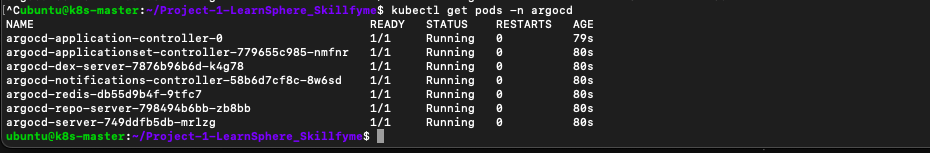
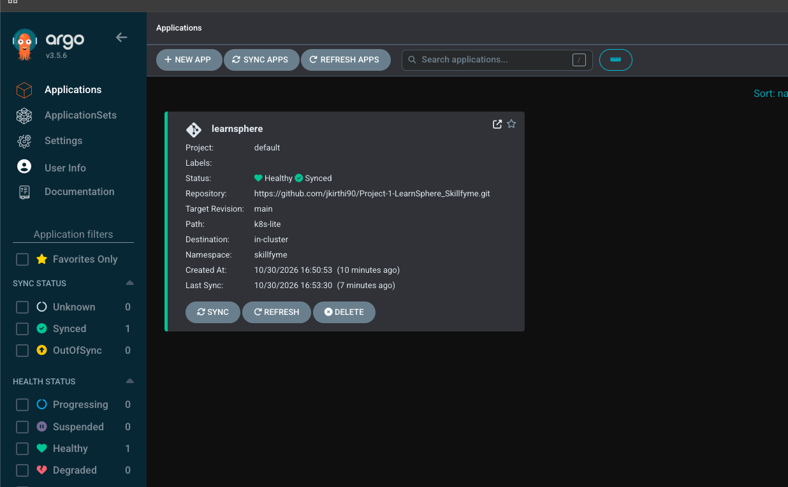
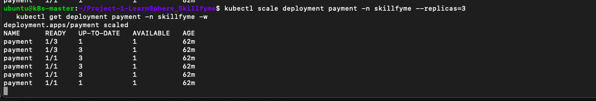

# Argo CD – GitOps Deployment

Argo CD watches `k8s-lite/` on `main` in the LearnSphere repo and keeps the cluster in sync with it.
Files in the project repo: `argocd/application.yaml`, `argocd/README.md`.

## Setup
- Installed Argo CD into namespace `argocd` (official manifest, server-side apply)
- UI exposed on a NodePort, logged in as `admin` with the initial secret
- Private repo connected with a repository Secret (token with `repo` scope)
- Application `learnsphere`: source `k8s-lite` on `main`, destination namespace `skillfyme`
- Sync policy: **automated**, `prune: true`, `selfHeal: true`, `CreateNamespace=true`
- Secrets and seed ConfigMaps are created with `kubectl`, so they stay out of Git

## Commands
```bash
# Git setup on the VM (once)
git config --global user.name "jkirthi90"
git config --global user.email "<github-email>"
git config --global credential.helper store
cd ~/Project-1-LearnSphere_Skillfyme && git pull

# 1. Install Argo CD
kubectl create namespace argocd
kubectl apply -n argocd --server-side --force-conflicts \
  -f https://raw.githubusercontent.com/argoproj/argo-cd/stable/manifests/install.yaml
kubectl get pods -n argocd -w

# 2. UI on a NodePort
kubectl patch svc argocd-server -n argocd -p '{"spec":{"type":"NodePort"}}'
kubectl get svc argocd-server -n argocd
kubectl get svc argocd-server -n argocd -o jsonpath='{.spec.ports[?(@.port==443)].nodePort}'; echo
# browser: https://<node-public-ip>:<nodeport>

# 3. Admin password (user: admin)
kubectl -n argocd get secret argocd-initial-admin-secret -o jsonpath="{.data.password}" | base64 -d; echo

# 4. Private repo access
kubectl -n argocd create secret generic learnsphere-repo \
  --from-literal=type=git \
  --from-literal=url=https://github.com/jkirthi90/Project-1-LearnSphere_Skillfyme.git \
  --from-literal=username=jkirthi90 \
  --from-literal=password=<token>
kubectl -n argocd label secret learnsphere-repo argocd.argoproj.io/secret-type=repository

# 5. Application
kubectl apply -f argocd/application.yaml
kubectl get applications -n argocd
kubectl describe application learnsphere -n argocd | tail -20     # if OutOfSync / Unknown
```

## Tests
```bash
# Self-heal – Argo CD reverts manual changes to the Git state
kubectl scale deployment payment -n skillfyme --replicas=3
kubectl get deployment payment -n skillfyme -w

# GitOps – a Git change is deployed without kubectl apply
#   edit replicas in k8s-lite/03-microservices.yaml, then:
git add k8s-lite && git commit -m "Scale payment to 2" && git push origin main
kubectl get deployment payment -n skillfyme -w
```
The Gateway API change was also deployed this way: merged the pull request, Argo CD synced it.

## Screenshots

**1. Argo CD running**

All 7 Argo CD components running: application controller, applicationset controller, dex, notifications, redis, repo server and API server.

**2. Application synced**

`learnsphere` is Healthy and Synced – private repo, `main` branch, path `k8s-lite`, namespace `skillfyme`.

**3. Self-heal**

Scaling payment to 3 replicas by hand: it briefly shows `1/3`, then Argo CD restores the 1 replica defined in Git.
