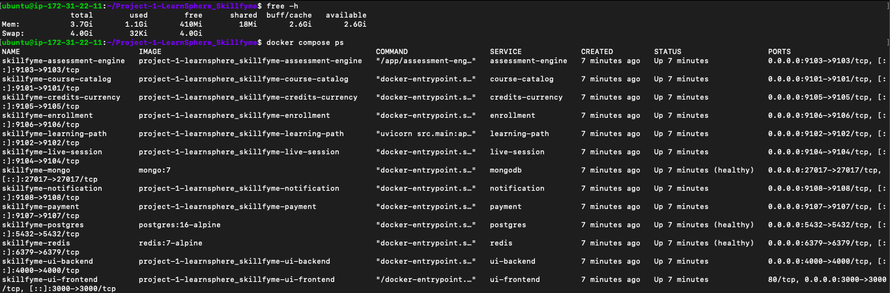
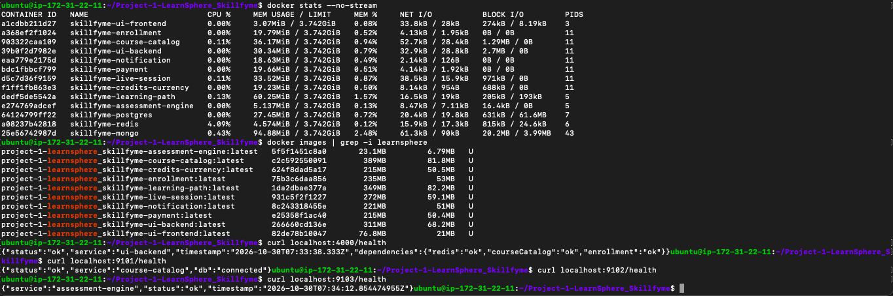
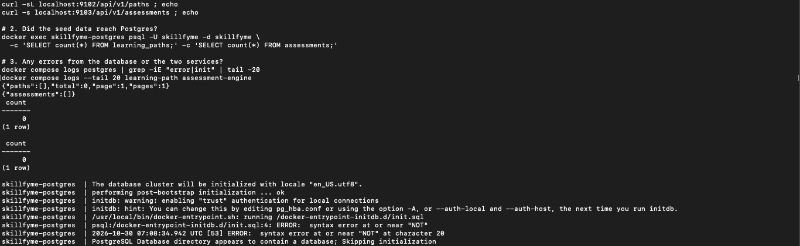
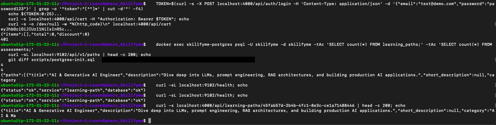
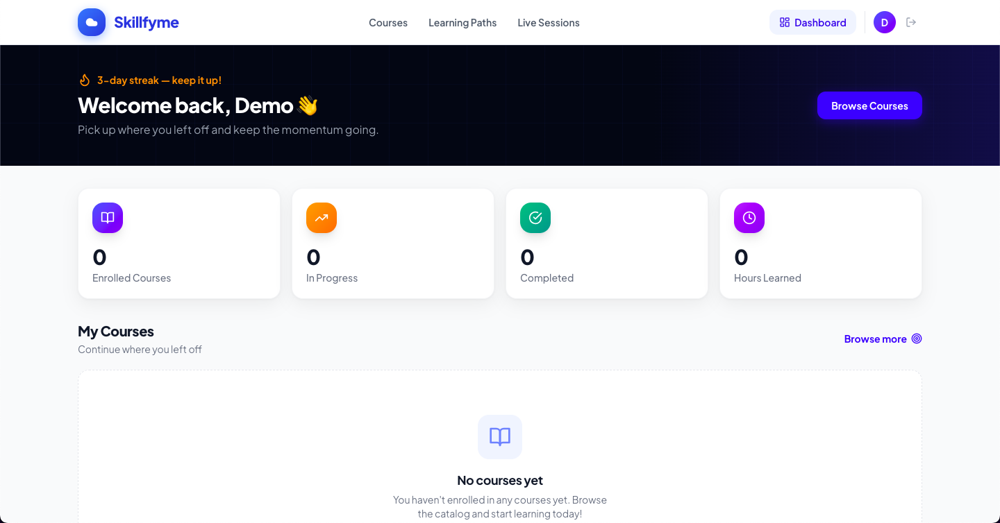
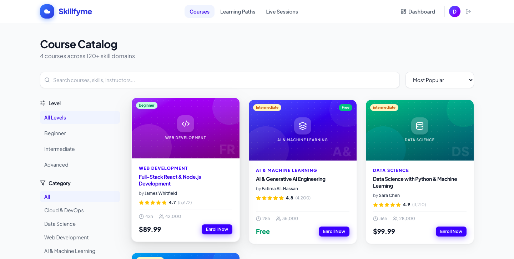
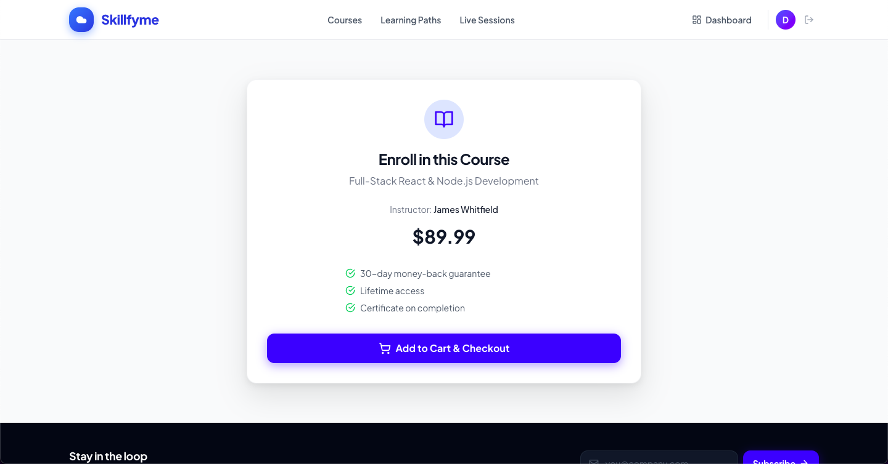
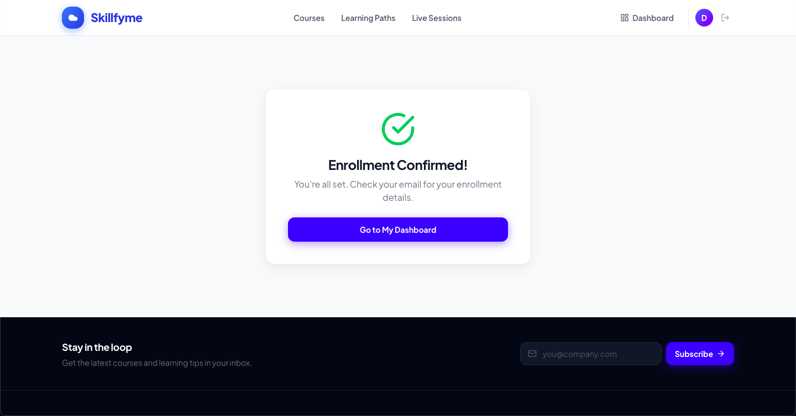
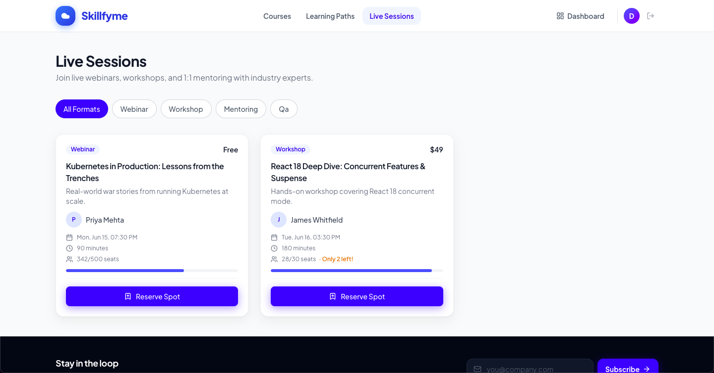

# Docker Compose Deployment – LearnSphere

Deployed the LearnSphere microservices platform on a single AWS EC2 instance with Docker Compose.

## Environment
- AWS EC2 t3.medium (2 vCPU, 4 GB), Ubuntu 24.04, Standard CPU credits
- 4 GB swap for image builds
- Lite stack: MongoDB, PostgreSQL, Redis + 10 app services
- Elasticsearch, Kafka and Zookeeper skipped – not used by any service code, and they don't fit in 4 GB

## Steps

**1. Add swap**
```bash
sudo fallocate -l 4G /swapfile && sudo chmod 600 /swapfile
sudo mkswap /swapfile && sudo swapon /swapfile
```

**2. Install Docker and clone the project**
```bash
git clone https://github.com/jkirthi90/Project-1-LearnSphere_Skillfyme.git
cd Project-1-LearnSphere_Skillfyme
```

**3. Fix the Postgres init script** – replace `scripts/postgres-init.sql` with [postgres-init.sql](./postgres-init.sql) (see Fix below)

**4. Build images one at a time** (parallel builds run out of memory)
```bash
for s in course-catalog learning-path assessment-engine credits-currency enrollment payment live-session notification ui-backend ui-frontend; do
  docker compose build $s
done
```

**5. Start databases, then app services**
```bash
docker compose up -d mongodb postgres redis
docker compose up -d --no-deps course-catalog learning-path assessment-engine \
  credits-currency enrollment payment live-session notification ui-backend ui-frontend
```

**6. Verify**
```bash
docker compose ps
curl localhost:4000/health
curl -sL localhost:9102/health
curl localhost:9103/health
```
UI: `http://<host>:3000` · API: `http://<host>:4000`

## Fix: Postgres seed data not loading

| | |
|---|---|
| Issue | Learning paths and assessments APIs returned empty lists |
| Cause | `postgres-init.sql` used MySQL syntax `CREATE DATABASE IF NOT EXISTS`, and `RAISE NOTICE` outside a `DO` block – the init script failed |
| Fix | Removed both lines ([postgres-init.sql](./postgres-init.sql)), recreated the volume with `docker compose down -v` |
| Result | learning_paths 0 → 4, assessments 0 → 4 |

## Known issues (in the provided application)
- Learning path detail page shows 404 – frontend has no route for `/learning-paths/:id`; the API works
- Course count / weeks blank on Learning Paths page – frontend expects camelCase, API returns snake_case
- Login is a demo – any email + 8-character password

## Screenshots

**1. Containers and memory**

`free -h` shows 3.7 GiB RAM with 4 GB swap. `docker compose ps` shows all 13 containers up and MongoDB, PostgreSQL and Redis healthy.

**2. Resource usage, images and health checks**

The whole stack uses under 400 MB of RAM. 10 application images built. Health checks return `ok` for ui-backend (with Redis, course-catalog and enrollment), course-catalog and assessment-engine.

**3. Bug – before the fix**

Learning paths and assessments APIs return empty lists, both tables have 0 rows, and the Postgres log shows `syntax error at or near "NOT"` in `init.sql`.

**4. After the fix – login, data and APIs**

Login returns a JWT; the cart works with the token and returns `401` without it. learning_paths and assessments now have 4 rows each. Learning-path health is `ok`, and `GET /api/learning-paths/<id>` returns data (the 404 is only in the frontend).

**5. Dashboard**

Logged in as the demo user; the dashboard loads through ui-backend.

**6. Course catalog**

4 published courses loaded from MongoDB through the course-catalog service, with level and category filters.

**7. Enroll in a course**

Course enrollment page with price and instructor from the catalog.

**8. Enrollment confirmed**

Add to cart (stored in Redis) and checkout through ui-backend complete successfully.

**9. Live sessions**

Live sessions loaded from MongoDB through the live-session service.
