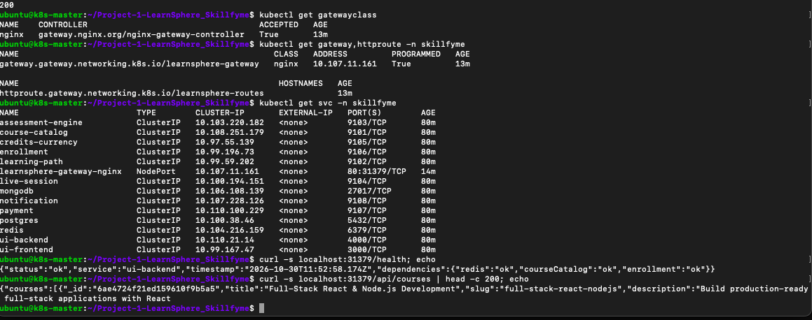
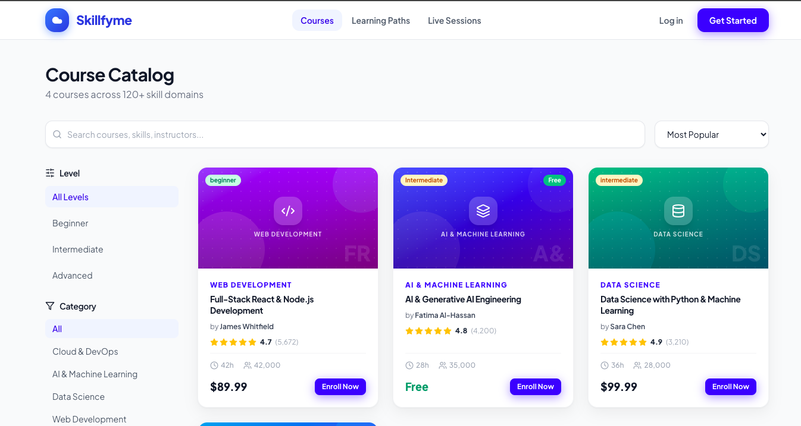
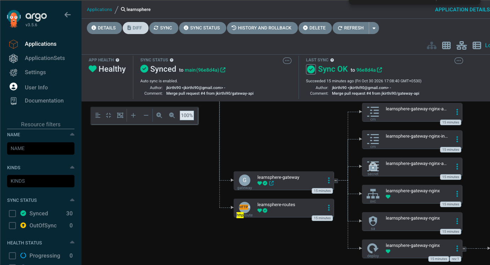

# Gateway API – Single Entry Point

Replaced the two NodePorts (UI 30300, API 30400) with a Gateway API `Gateway` and `HTTPRoute`.
Controller: **NGINX Gateway Fabric 2.8.0**. Manifest in the project repo: `k8s-lite/05-gateway.yaml`, deployed by Argo CD.

```
Browser ─► <node-ip>:31379 ─► Gateway learnsphere-gateway (nginx)
                                ├─ /api, /health ─► ui-backend:4000
                                └─ /             ─► ui-frontend:3000
```

## Why Gateway API
- One entry point instead of a NodePort per service; ui-frontend and ui-backend are now ClusterIP
- Path-based routing defined in Kubernetes, not in app config
- Gateway API is the successor to Ingress; the community ingress-nginx controller was retired in 2026

## Commands
Installed the controller **before** merging, so Argo CD could create the Gateway (the CRDs must exist first).
```bash
# 1. Helm
curl -fsSL https://raw.githubusercontent.com/helm/helm/main/scripts/get-helm-3 | bash
helm version

# 2. Gateway API CRDs
kubectl kustomize "https://github.com/nginx/nginx-gateway-fabric/config/crd/gateway-api/standard?ref=v2.8.0" | kubectl apply -f -

# 3. NGINX Gateway Fabric
helm install ngf oci://ghcr.io/nginx/charts/nginx-gateway-fabric \
  --create-namespace -n nginx-gateway --set nginx.service.type=NodePort --wait
kubectl get gatewayclass

# 4. Merge the pull request → Argo CD syncs; then
cd ~/Project-1-LearnSphere_Skillfyme && git pull
kubectl get gateway,httproute -n skillfyme
kubectl get svc -n skillfyme
kubectl get svc -n skillfyme | grep gateway                  # NodePort 80:31379

# 5. Test
curl -s localhost:31379/health; echo
curl -s localhost:31379/api/courses | head -c 200; echo
curl -s -o /dev/null -w "%{http_code}\n" localhost:31379/
```

## Troubleshooting commands
```bash
kubectl get svc learnsphere-gateway-nginx -n skillfyme -o jsonpath='{.spec.externalTrafficPolicy}'; echo
kubectl get pods -n skillfyme -o wide | grep gateway        # node running the gateway pod
curl -s https://checkip.amazonaws.com                       # this node's public IP
kubectl get svc -A | grep -i nginx
```

## Issue
| Issue | Cause | Fix |
|-------|-------|-----|
| Browser timed out on port 31379 | NGINX Gateway Fabric's service uses `externalTrafficPolicy: Local`, so the NodePort only answers on the node running the gateway pod | Browsed to that node's public IP |

## Screenshots

**1. Gateway resources and routing test**

GatewayClass `nginx` accepted, Gateway programmed, HTTPRoute created. Only `learnsphere-gateway-nginx` is a NodePort (31379); `/health` and `/api/courses` answer through the Gateway.

**2. UI through the Gateway**

LearnSphere served on port 31379 – the page from ui-frontend, its data from ui-backend, both routed by the HTTPRoute.

**3. Deployed by Argo CD**

Argo CD synced the Gateway and HTTPRoute from the merged pull request; the tree shows the nginx Deployment, Service and ConfigMaps the controller created for the Gateway.
