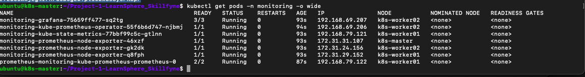
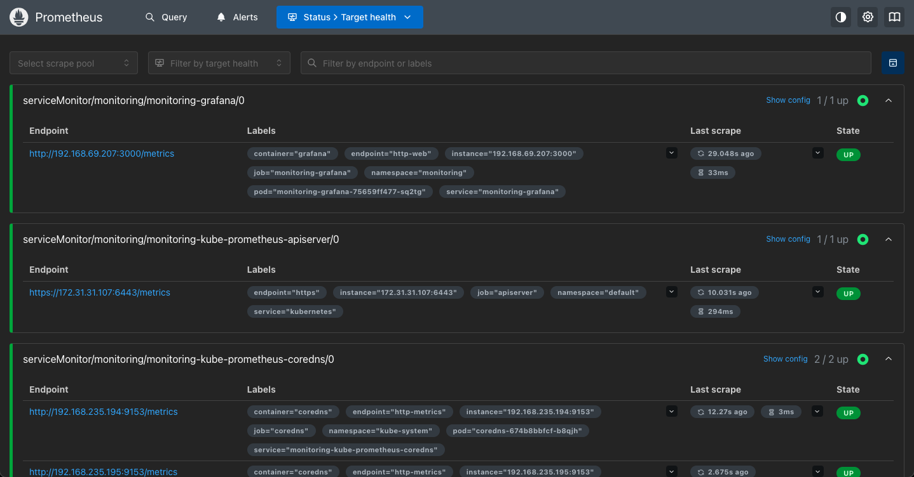
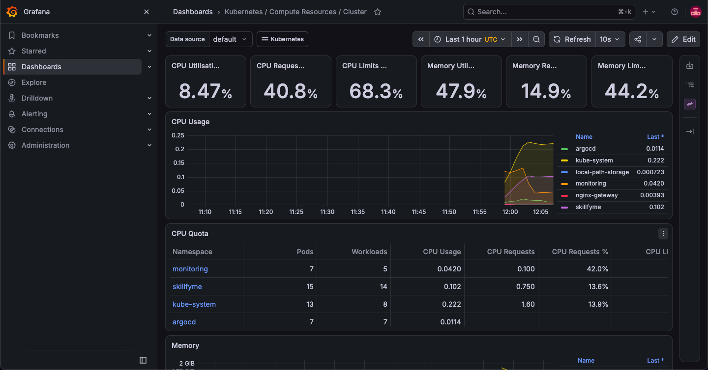
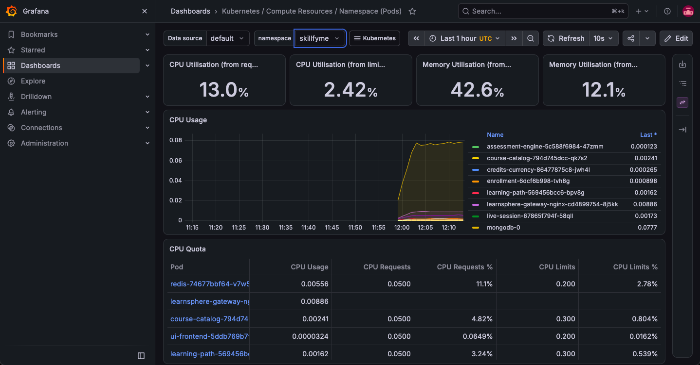
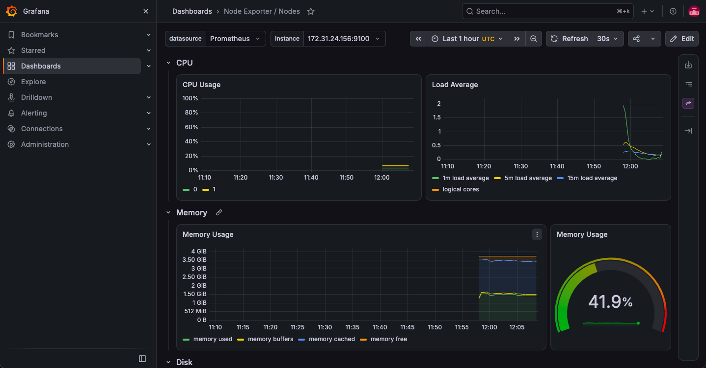
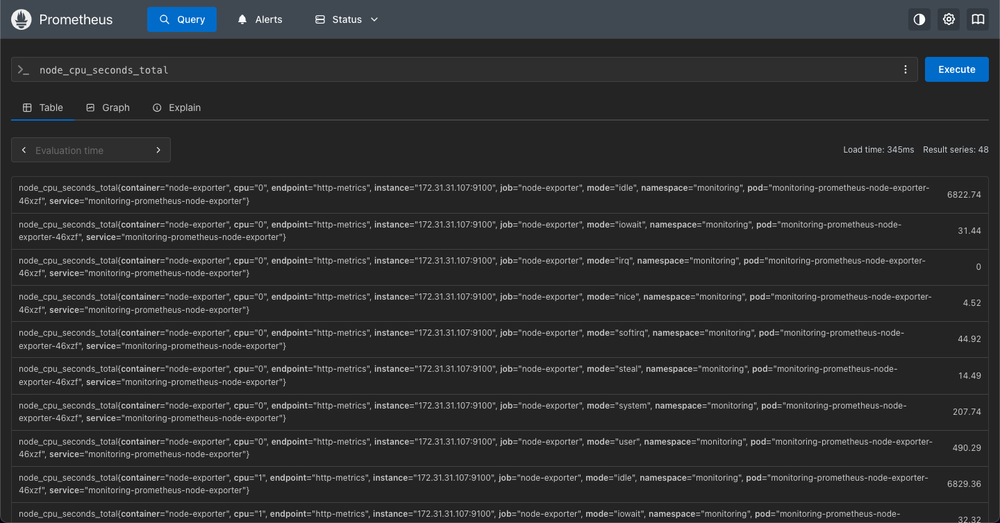

# Monitoring – Prometheus & Grafana

**kube-prometheus-stack** installed with Helm: Prometheus Operator, Prometheus, Grafana, node-exporter, kube-state-metrics.
Values in the project repo: `monitoring/values.yaml`.

## Settings (`values.yaml`)
- Alertmanager disabled (no alert receivers in the lab)
- Prometheus retention 2 days, memory limit 1 GiB
- NodePorts: Grafana **32000**, Prometheus **30090**
- etcd, scheduler, controller-manager and kube-proxy monitors disabled – kubeadm binds them to 127.0.0.1, so they'd always show as down

## Commands
```bash
cd ~/Project-1-LearnSphere_Skillfyme && git pull

# 1. Install
helm repo add prometheus-community https://prometheus-community.github.io/helm-charts
helm repo update
helm install monitoring prometheus-community/kube-prometheus-stack \
  -n monitoring --create-namespace -f monitoring/values.yaml --wait

# 2. Check
kubectl get pods -n monitoring -o wide
kubectl get svc -n monitoring | grep -E "grafana|prometheus "

# 3. Grafana admin password (user: admin)
kubectl -n monitoring get secret monitoring-grafana -o jsonpath="{.data.admin-password}" | base64 -d; echo
```
- Grafana: `http://<node-public-ip>:32000`
- Prometheus: `http://<node-public-ip>:30090` → Status → Target health

**Dashboards used:** Kubernetes / Compute Resources / Cluster · Kubernetes / Compute Resources / Namespace (Pods) → namespace `skillfyme` · Node Exporter / Nodes

**PromQL used:**
```
node_cpu_seconds_total
sum(container_memory_working_set_bytes{namespace="skillfyme", container!=""}) by (pod)
sum(kube_pod_container_status_restarts_total{namespace="skillfyme"}) by (pod)
```

**Limitation:** the LearnSphere services don't expose `/metrics`, so dashboards show resource usage, restarts and node health, not request counts.

## Screenshots

**1. Monitoring stack running**

7 pods across the 3 nodes – Grafana, operator, kube-state-metrics, Prometheus, and a node-exporter on every node.

**2. Prometheus targets**

Scrape targets UP – Grafana, the Kubernetes API server and CoreDNS.

**3. Cluster overview**

Whole cluster: 8.5% CPU and 48% memory used. Per namespace: skillfyme (15 pods), monitoring, kube-system, argocd, nginx-gateway.

**4. LearnSphere pods**

CPU and memory per LearnSphere service, including the gateway pod; MongoDB is the heaviest at ~0.08 CPU.

**5. Node health**

Per-node CPU, load and memory (42% used) from node-exporter.

**6. PromQL query**

`node_cpu_seconds_total` returns 48 series from the node-exporters – Prometheus is collecting node metrics.
